

<a href="https://flagquiz.warze.org">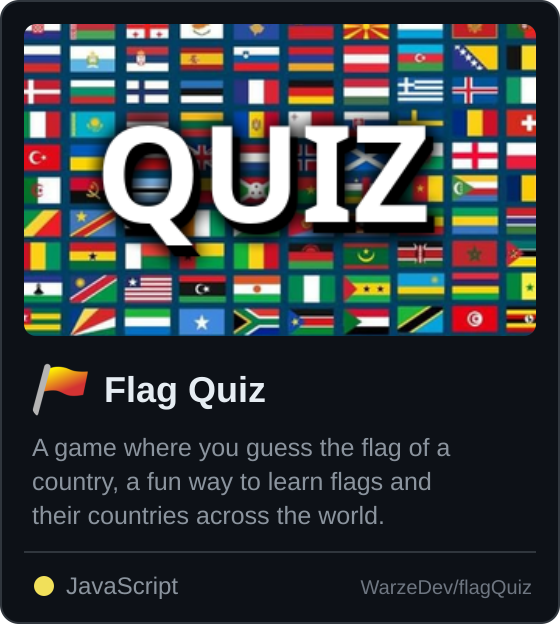</a>
<a href="https://jollyworld.app">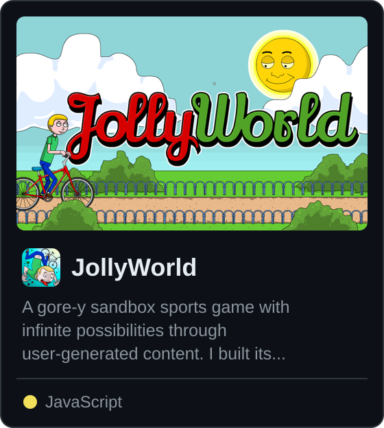</a>

<a href="https://casino.warze.dev/2">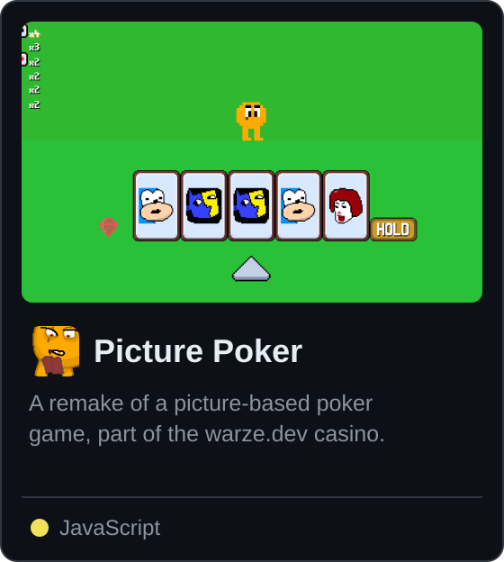</a>

<a href="https://reactidle.warze.dev/">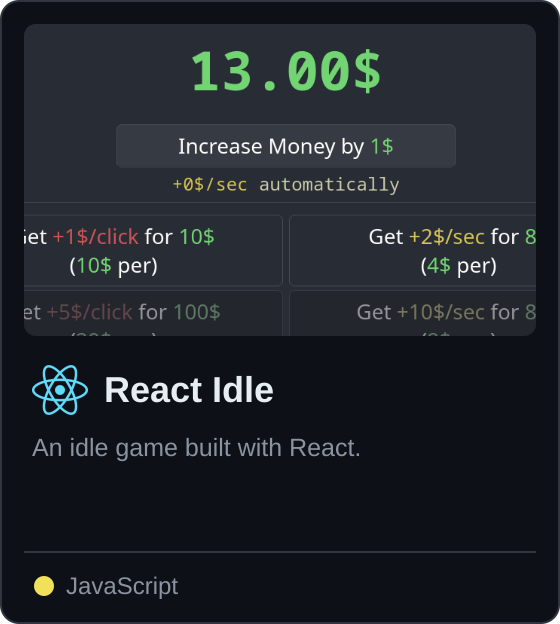</a>

<a href="https://poki.com/en/g/jelly-venture">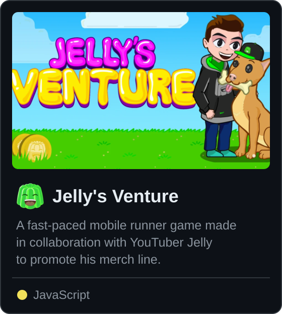</a>

<a href="https://warzedev.github.io/linkedInBannerCreator/">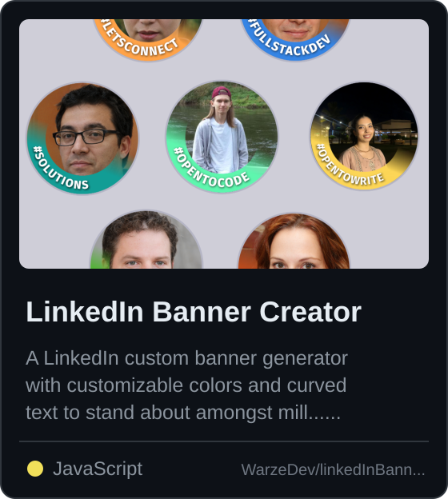</a>
<a href="https://models.warze.dev">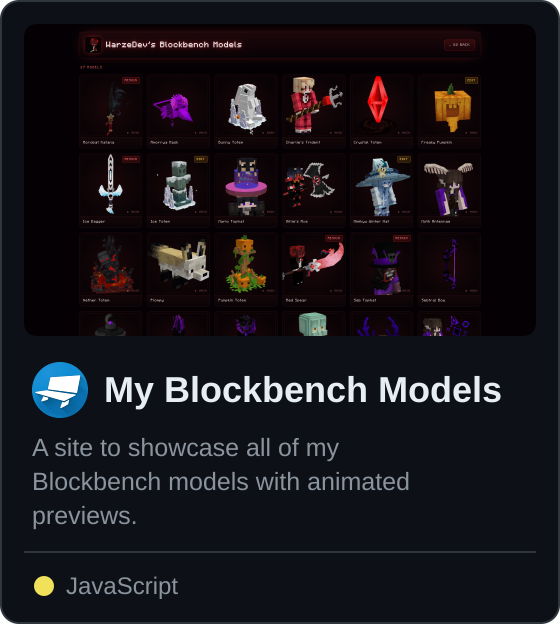</a>
<a href="https://warzedev.github.io/pixelArtToJollyData/">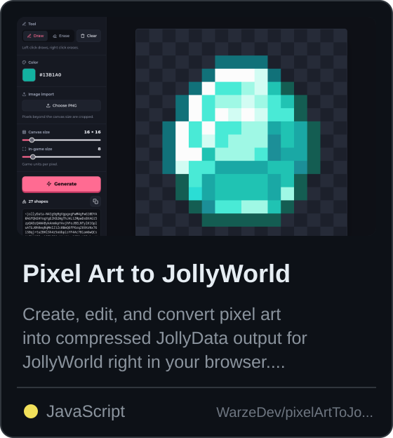</a>

<a href="https://blanket.warze.dev">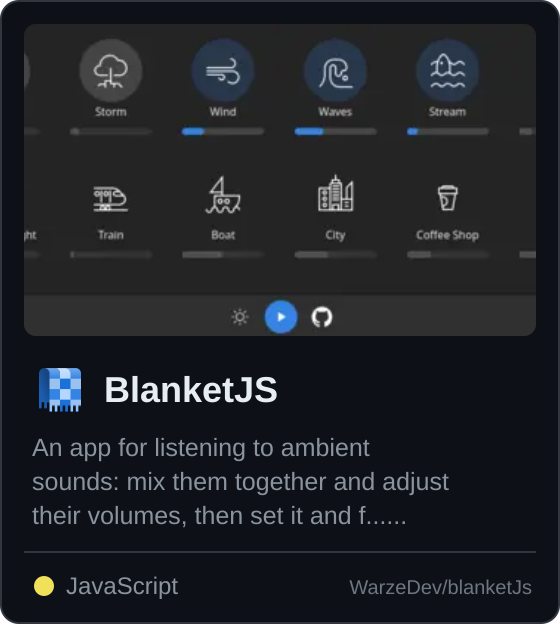</a>
<a href="https://home.warze.dev">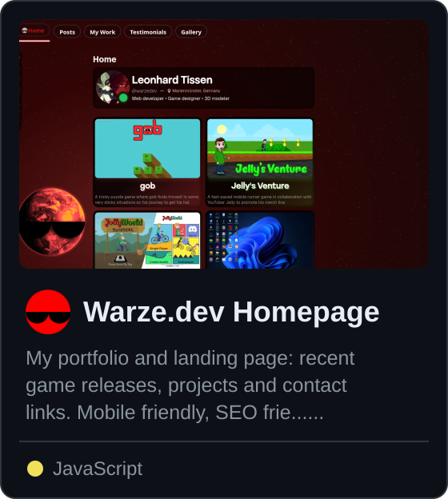</a>

<a href="https://wartos.warze.dev">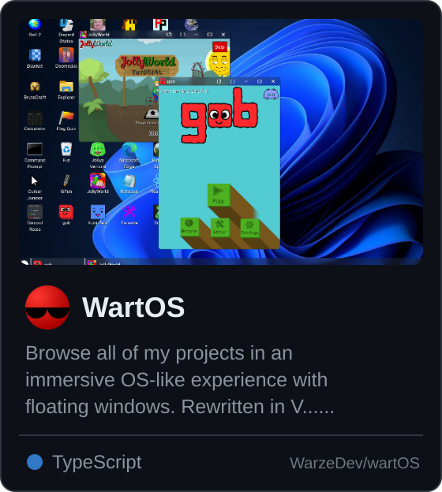</a>
<a href="https://discordstatus.warze.dev">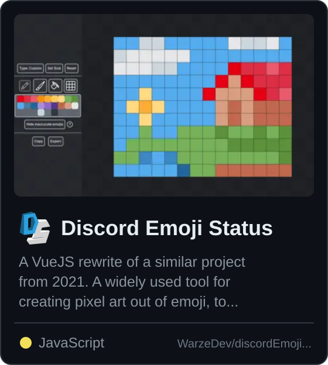</a>

<a href="https://github.com/WarzeDev/discordChannelMerger">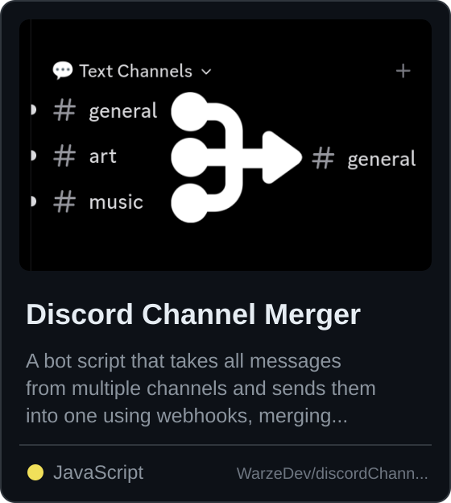</a>
<a href="https://discord.gg/jtcqgvkZY7">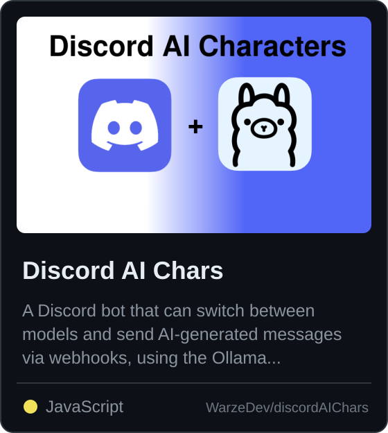</a>

