## Games

<table cellspacing="0" cellpadding="2" width="732">

<tr>
<td width="240" valign="top" align="center">
    
  </td>
<td width="240" valign="top" align="center">
    <a href="https://blurpstone.warze.dev">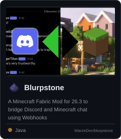</a>
  </td>
<td width="240" valign="top" align="center">
    
  </td>
</tr>

<tr>
<td width="240" valign="top" align="center">
    <a href="https://lightson2.warze.dev">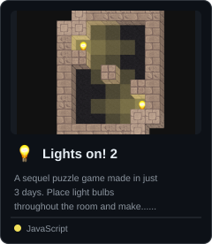</a>
  </td>
<td width="240" valign="top" align="center">
    
  </td>
<td width="240" valign="top" align="center">
    
  </td>
</tr>

<tr>
<td width="240" valign="top" align="center">
    
  </td>
<td width="240" valign="top" align="center">
    <a href="https://squishyearth.warze.org">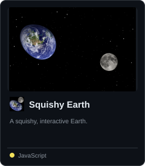</a>
  </td>
<td width="240" valign="top" align="center">
    <a href="https://warze.org/casinodrink">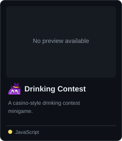</a>
  </td>
</tr>

<tr>
<td width="240" valign="top" align="center">
    <a href="https://warze.org/casino">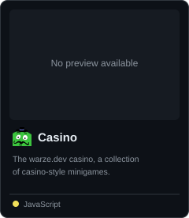</a>
  </td>
<td width="240" valign="top" align="center">
    
  </td>
<td width="240" valign="top" align="center">
    
  </td>
</tr>

<tr>
<td width="240" valign="top" align="center">
    
  </td>
<td width="240" valign="top" align="center">
    
  </td>
<td width="240" valign="top" align="center">
    <a href="https://snake.warze.org">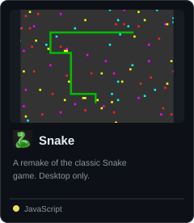</a>
  </td>
</tr>

<tr>
<td width="240" valign="top" align="center">
    
  </td>
<td width="240" valign="top" align="center">
    
  </td>
<td width="240" valign="top" align="center">
    
  </td>
</tr>

<tr>
<td width="240" valign="top" align="center">
    <a href="https://kubipets.warze.dev">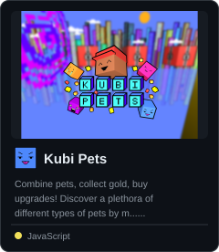</a>
  </td>
<td width="240" valign="top" align="center">
    
  </td>
<td width="240" valign="top" align="center">
    
  </td>
</tr>

<tr>
<td width="240" valign="top" align="center">
    <a href="https://gob.warze.dev">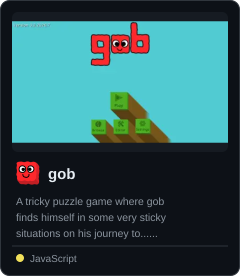</a>
  </td>
<td width="240" valign="top" align="center">
    
  </td>
<td width="240"></td>
</tr>
</table>

## Websites & Tools

<table cellspacing="0" cellpadding="2" width="732">

<tr>
<td width="240" valign="top" align="center">
    
  </td>
<td width="240" valign="top" align="center">
    
  </td>
<td width="240" valign="top" align="center">
    
  </td>
</tr>

<tr>
<td width="240" valign="top" align="center">
    
  </td>
<td width="240" valign="top" align="center">
    
  </td>
<td width="240" valign="top" align="center">
    
  </td>
</tr>

<tr>
<td width="240" valign="top" align="center">
    
  </td>
<td width="240" valign="top" align="center">
    <a href="https://cssbook.warze.dev">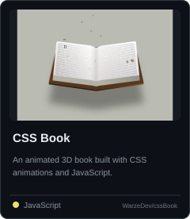</a>
  </td>
<td width="240" valign="top" align="center">
    
  </td>
</tr>

<tr>
<td width="240" valign="top" align="center">
    
  </td>
<td width="240" valign="top" align="center">
    
  </td>
<td width="240" valign="top" align="center">
    <a href="https://fun.warze.org/calculator">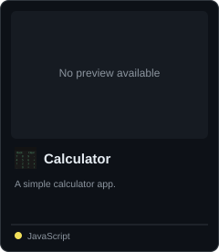</a>
  </td>
</tr>

<tr>
<td width="240" valign="top" align="center">
    <a href="https://fun.warze.org/notepad">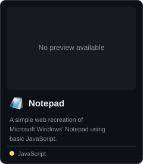</a>
  </td>
<td width="240" valign="top" align="center">
    <a href="https://cursorjumper.warze.org/">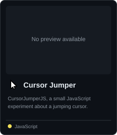</a>
  </td>
<td width="240" valign="top" align="center">
    
  </td>
</tr>

<tr>
<td width="240" valign="top" align="center">
    <a href="https://cmd.warze.org">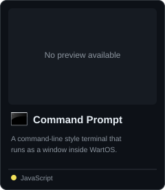</a>
  </td>
<td width="240"></td>
<td width="240"></td>
</tr>
</table>

## Discord Bots

<table cellspacing="0" cellpadding="2" width="732">

<tr>
<td width="240" valign="top" align="center">
    
  </td>
<td width="240" valign="top" align="center">
    
  </td>
<td width="240" valign="top" align="center">
    
  </td>
</tr>

<tr>
<td width="240" valign="top" align="center">
    <a href="https://discord.warze.org">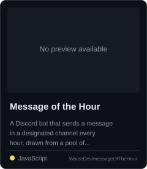</a>
  </td>
<td width="240" valign="top" align="center">
    
  </td>
<td width="240" valign="top" align="center">
    
  </td>
</tr>

<tr>
<td width="240" valign="top" align="center">
    <a href="https://code.warze.dev">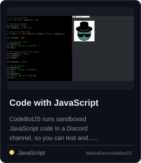</a>
  </td>
<td width="240" valign="top" align="center">
    <a href="https://discord.gg/jtcqgvkZY7">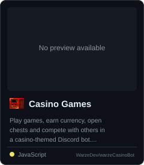</a>
  </td>
<td width="240"></td>
</tr>
</table>
