## Games

<table cellspacing="0" cellpadding="3" width="759">

<tr>
  <td width="250" valign="top" align="center">
    <a href="https://ytguessr.warze.dev">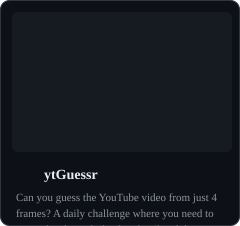</a>
  </td>
  <td width="250" valign="top" align="center">
    <a href="https://blurpstone.warze.dev">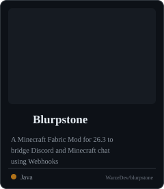</a>
  </td>
  <td width="250" valign="top" align="center">
    <a href="https://icecream.warze.dev">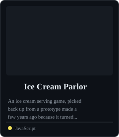</a>
  </td>
</tr>

<tr>
  <td width="250" valign="top" align="center">
    <a href="https://lightson2.warze.dev">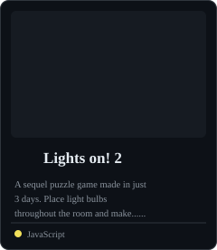</a>
  </td>
  <td width="250" valign="top" align="center">
    <a href="https://lightson.warze.dev">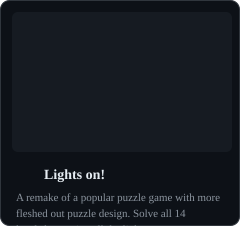</a>
  </td>
  <td width="250" valign="top" align="center">
    <a href="https://flagquiz.warze.org">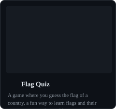</a>
  </td>
</tr>

<tr>
  <td width="250" valign="top" align="center">
    <a href="https://jollyworld.app">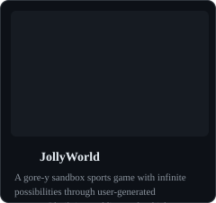</a>
  </td>
  <td width="250" valign="top" align="center">
    <a href="https://squishyearth.warze.org">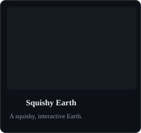</a>
  </td>
  <td width="250" valign="top" align="center">
    <a href="https://warze.org/casinodrink">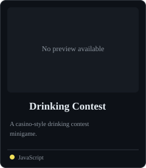</a>
  </td>
</tr>

<tr>
  <td width="250" valign="top" align="center">
    <a href="https://warze.org/casino">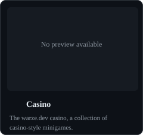</a>
  </td>
  <td width="250" valign="top" align="center">
    <a href="https://casino.warze.dev/3">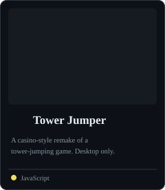</a>
  </td>
  <td width="250" valign="top" align="center">
    <a href="https://casino.warze.dev/2">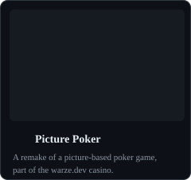</a>
  </td>
</tr>

<tr>
  <td width="250" valign="top" align="center">
    <a href="https://casino.warze.dev/1">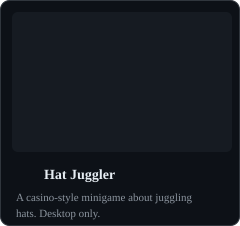</a>
  </td>
  <td width="250" valign="top" align="center">
    <a href="https://fun.warze.org/laibart">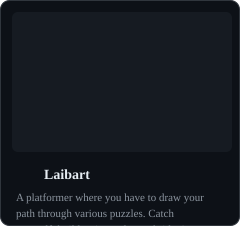</a>
  </td>
  <td width="250" valign="top" align="center">
    <a href="https://snake.warze.org">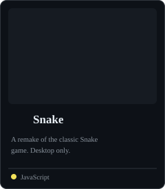</a>
  </td>
</tr>

<tr>
  <td width="250" valign="top" align="center">
    <a href="https://pushy.warze.org">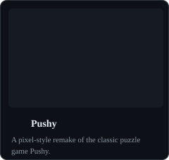</a>
  </td>
  <td width="250" valign="top" align="center">
    <a href="https://reactidle.warze.dev/">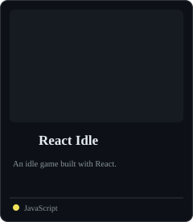</a>
  </td>
  <td width="250" valign="top" align="center">
    <a href="https://happywheels.warze.dev">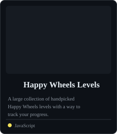</a>
  </td>
</tr>

<tr>
  <td width="250" valign="top" align="center">
    <a href="https://kubipets.warze.dev">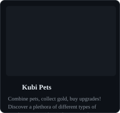</a>
  </td>
  <td width="250" valign="top" align="center">
    <a href="https://parasite.warze.dev/">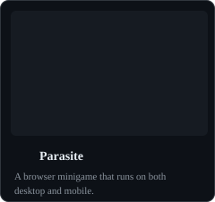</a>
  </td>
  <td width="250" valign="top" align="center">
    <a href="https://poki.com/en/g/jelly-venture">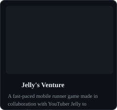</a>
  </td>
</tr>

<tr>
  <td width="250" valign="top" align="center">
    <a href="https://gob.warze.dev">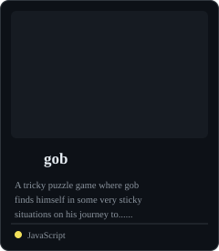</a>
  </td>
  <td width="250" valign="top" align="center">
    <a href="https://doomed.io">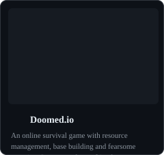</a>
  </td>
  <td width="250" valign="top" align="center">
    &nbsp;
  </td>
</tr>
</table>

## Websites & Tools

<table cellspacing="0" cellpadding="3" width="759">

<tr>
  <td width="250" valign="top" align="center">
    <a href="https://warzedev.github.io/linkedInBannerCreator/">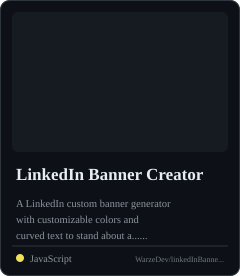</a>
  </td>
  <td width="250" valign="top" align="center">
    <a href="https://models.warze.dev">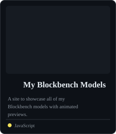</a>
  </td>
  <td width="250" valign="top" align="center">
    <a href="https://warzedev.github.io/pixelArtToJollyData/">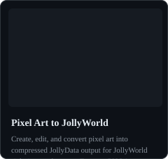</a>
  </td>
</tr>

<tr>
  <td width="250" valign="top" align="center">
    <a href="https://brutecraft.warze.dev">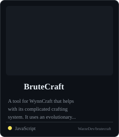</a>
  </td>
  <td width="250" valign="top" align="center">
    <a href="https://blanket.warze.dev">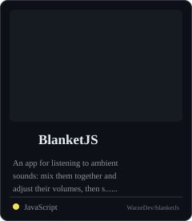</a>
  </td>
  <td width="250" valign="top" align="center">
    <a href="https://home.warze.dev">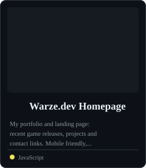</a>
  </td>
</tr>

<tr>
  <td width="250" valign="top" align="center">
    <a href="https://ball2.warze.dev">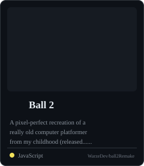</a>
  </td>
  <td width="250" valign="top" align="center">
    <a href="https://cssbook.warze.dev">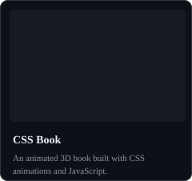</a>
  </td>
  <td width="250" valign="top" align="center">
    <a href="https://wartos.warze.dev">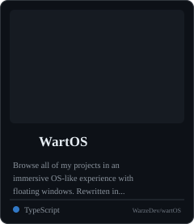</a>
  </td>
</tr>

<tr>
  <td width="250" valign="top" align="center">
    <a href="https://discordstatus.warze.dev">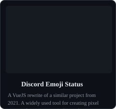</a>
  </td>
  <td width="250" valign="top" align="center">
    <a href="https://permaplace.warze.dev">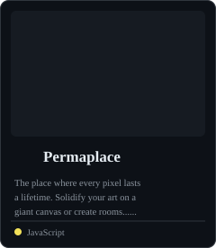</a>
  </td>
  <td width="250" valign="top" align="center">
    <a href="https://fun.warze.org/calculator">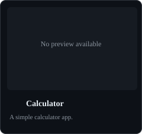</a>
  </td>
</tr>

<tr>
  <td width="250" valign="top" align="center">
    <a href="https://fun.warze.org/notepad">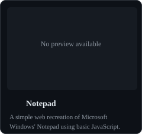</a>
  </td>
  <td width="250" valign="top" align="center">
    <a href="https://cursorjumper.warze.org/">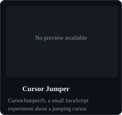</a>
  </td>
  <td width="250" valign="top" align="center">
    <a href="https://spacebackground.warze.org/">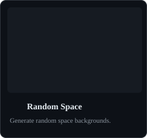</a>
  </td>
</tr>

<tr>
  <td width="250" valign="top" align="center">
    <a href="https://cmd.warze.org">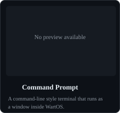</a>
  </td>
  <td width="250" valign="top" align="center">
    &nbsp;
  </td>
  <td width="250" valign="top" align="center">
    &nbsp;
  </td>
</tr>
</table>

## Discord Bots

<table cellspacing="0" cellpadding="3" width="759">

<tr>
  <td width="250" valign="top" align="center">
    <a href="https://discord.com/oauth2/authorize?client_id=1546507702375555102">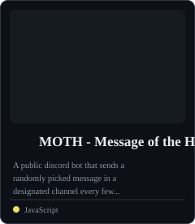</a>
  </td>
  <td width="250" valign="top" align="center">
    <a href="https://github.com/WarzeDev/discordChannelMerger">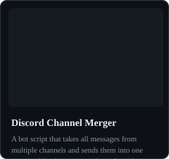</a>
  </td>
  <td width="250" valign="top" align="center">
    <a href="https://discord.gg/jtcqgvkZY7">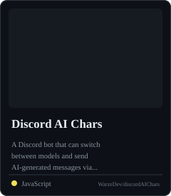</a>
  </td>
</tr>

<tr>
  <td width="250" valign="top" align="center">
    <a href="https://discord.warze.org">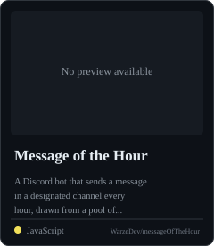</a>
  </td>
  <td width="250" valign="top" align="center">
    <a href="https://discord.gg/jtcqgvkZY7">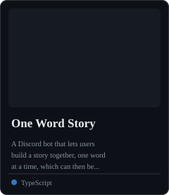</a>
  </td>
  <td width="250" valign="top" align="center">
    <a href="https://discord.gg/jtcqgvkZY7">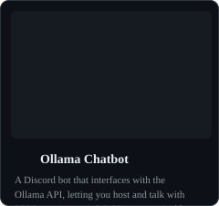</a>
  </td>
</tr>

<tr>
  <td width="250" valign="top" align="center">
    <a href="https://code.warze.dev">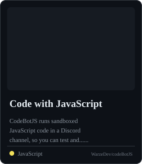</a>
  </td>
  <td width="250" valign="top" align="center">
    <a href="https://discord.gg/jtcqgvkZY7">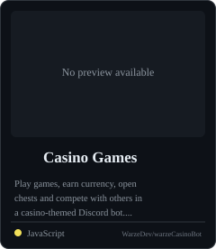</a>
  </td>
  <td width="250" valign="top" align="center">
    &nbsp;
  </td>
</tr>
</table>
