

<a href="https://icecream.warze.dev">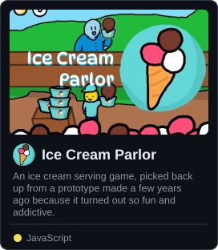</a>

<a href="https://lightson.warze.dev">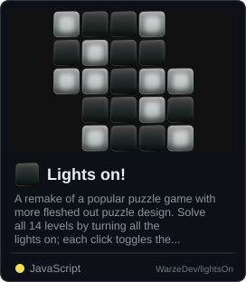</a>

<a href="https://casino.warze.dev/3">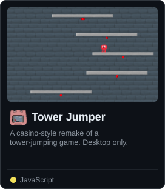</a>

<a href="https://casino.warze.dev/1">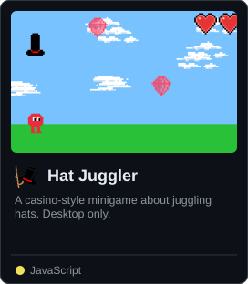</a>
<a href="https://fun.warze.org/laibart">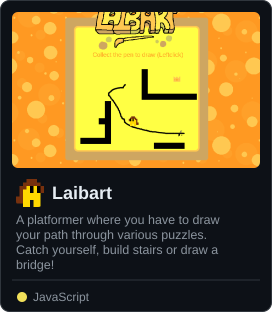</a>

<a href="https://pushy.warze.org">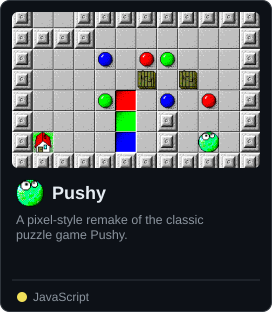</a>

<a href="https://happywheels.warze.dev">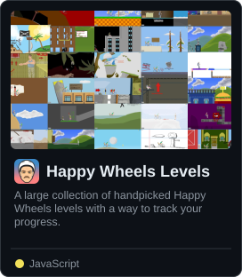</a>

<a href="https://parasite.warze.dev/">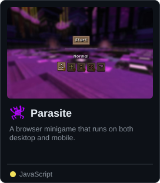</a>

<a href="https://doomed.io">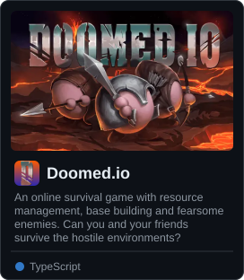</a>

<a href="https://brutecraft.warze.dev">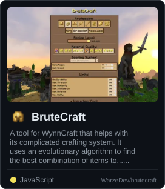</a>

<a href="https://ball2.warze.dev">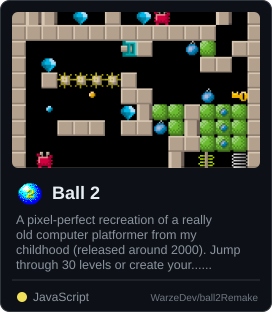</a>

<a href="https://permaplace.warze.dev">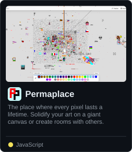</a>
<a href="https://spacebackground.warze.org/">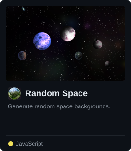</a>

<a href="https://discord.com/oauth2/authorize?client_id=1546507702375555102">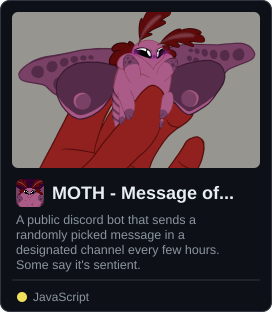</a>

<a href="https://discord.gg/jtcqgvkZY7">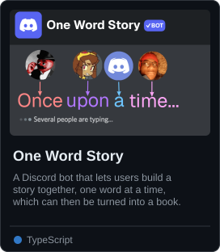</a>

